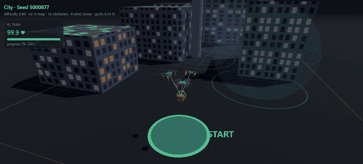
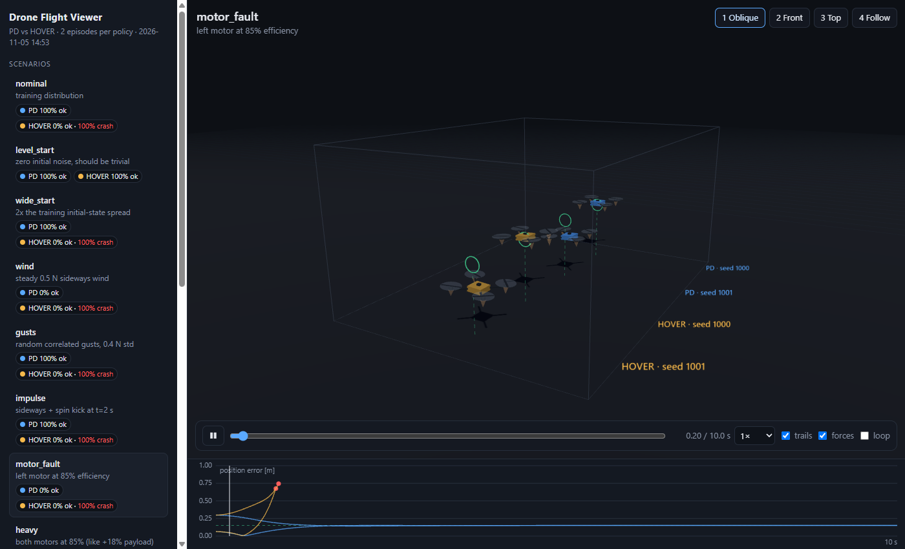
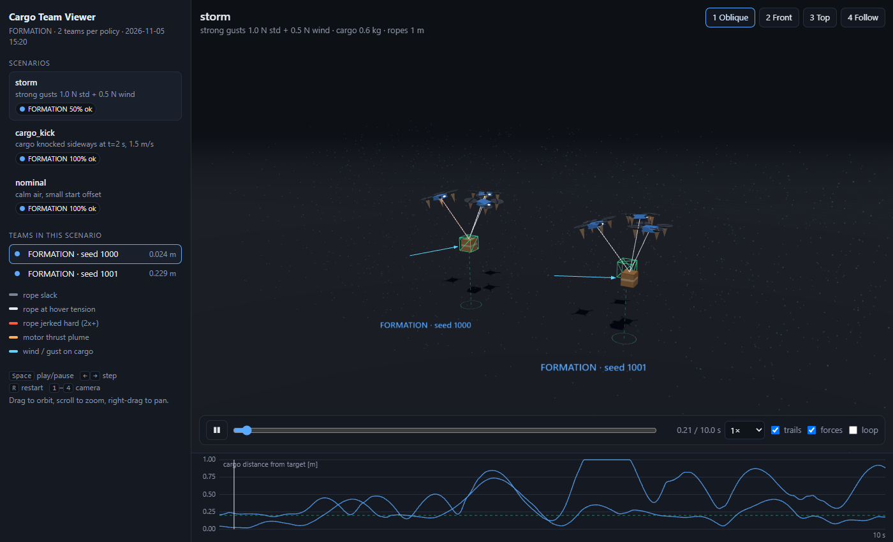
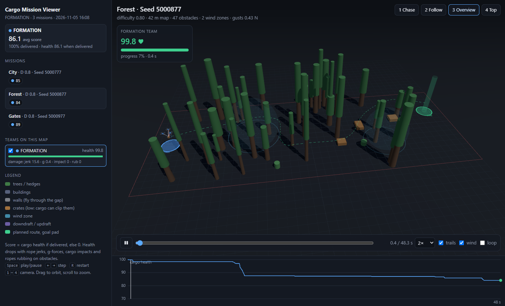
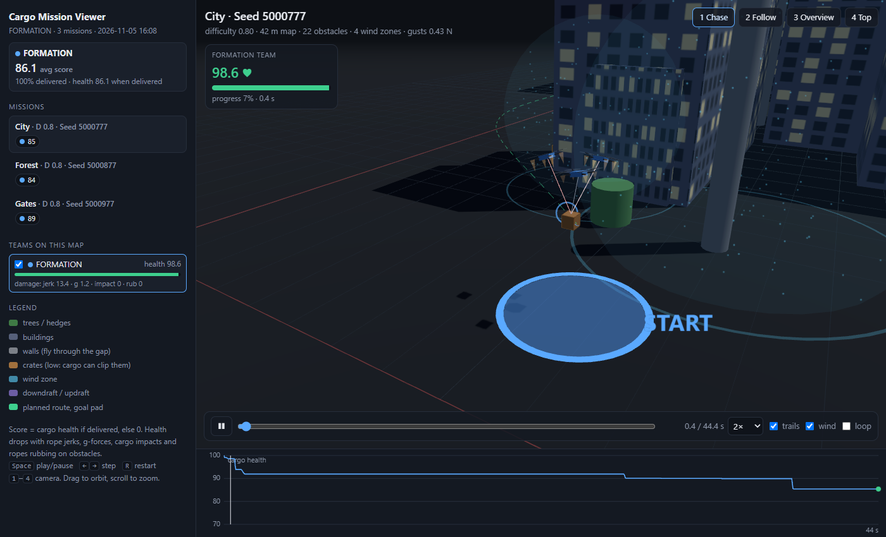

<div align="center">

# dronelab

**Reinforcement learning for drone teams carrying slung cargo through wind, gusts and generated obstacle maps.**

[](https://github.com/rrr090/dronelab/actions/workflows/tests.yml)
[](https://www.python.org/)
[](https://pytorch.org/)
[](https://numpy.org/)
[](https://threejs.org/)
[](LICENSE)
<br>
[](https://github.com/rrr090/dronelab/stargazers)
[](https://github.com/rrr090/dronelab/network/members)
[](https://github.com/rrr090/dronelab/commits/main)
[](https://github.com/rrr090/dronelab)



<sub>A trained three-drone team flies a cargo through an unseen city map, with wind zones and gusts, and delivers it with 98% health. The recording comes from the built-in 3D viewer.</sub>

**[Live demo](https://rrr090.github.io/dronelab/)** · [Quick start](#quick-start) · [How it works](#how-it-works) · [Results](#results) · [Project layout](#project-layout) · [Roadmap](#roadmap)

</div>

---

## Highlights

- **Full 3D multi-drone physics in NumPy.** Rigid-body quadrotors with four motors each, a cargo on elastic ropes that can go slack and snap tight, and turbulent gusts. Everything is vectorized over a batch of environments.
- **Procedural missions.** Forest, city, gate, storm and mixed maps are generated from a seed, with an A\* route planner and a cargo-health score.
- **PPO from scratch.** One small, readable trainer with observation normalization, GAE, a curriculum and warm starts between stages.
- **A baseline and a test suite at every stage.** Every policy is scored against a hand-written controller on unseen scenarios.
- **Interactive 3D viewers.** Each viewer is a single self-contained HTML file with chase, follow, overview and top cameras, a health HUD and a damage chart.

## Stages

| Stage | Task | Network |
|---|---|---|
| **hover** | One planar quadrotor holds a hover point under pushes and motor faults. | 6 → 2 motor thrusts |
| **cargo** | Three 3D quadrotors hold one cargo on ropes under gusts, wind, motor faults and cargo kicks. | 63 → 12 attitude commands |
| **mission** | The team flies the cargo through a generated map to a goal pad. Score = cargo health on delivery. | 93 → 12 attitude commands |

Each stage builds on the one before it.

<table>
  <tr>
    <td width="33%"></td>
    <td width="33%"></td>
    <td width="33%"></td>
  </tr>
  <tr>
    <td align="center"><sub><b>hover:</b> 12 disturbance scenarios</sub></td>
    <td align="center"><sub><b>cargo:</b> holding a load in a storm</sub></td>
    <td align="center"><sub><b>mission:</b> forest map with wind zones</sub></td>
  </tr>
</table>

## Quick start

```bash
git clone https://github.com/rrr090/dronelab.git && cd dronelab
python -m venv .venv
source .venv/bin/activate            # Windows: .venv\Scripts\activate
pip install -e ".[dev]"
```

> [!TIP]
> For GPU training, install the CUDA build of PyTorch first
> ([pytorch.org/get-started](https://pytorch.org/get-started/locally/)). The physics runs
> on the CPU, so a GPU only speeds up the network updates.

Every stage has the same three commands:

```bash
dronelab <task> train        # train a policy with PPO   -> checkpoints/
dronelab <task> evaluate     # score it on the test suite
dronelab <task> visualize    # open the 3D viewer         -> outputs/
```

For example:

```bash
dronelab cargo train                           # ~20 min on a laptop CPU
dronelab cargo visualize --policy rl formation # trained vs baseline, side by side
dronelab mission train                         # learns corrections on top of the baseline
dronelab mission visualize --themes storm city --difficulty 1.0
dronelab mission site                          # rebuild the project site    -> site/
```

`python -m dronelab ...` works without installing. Add `--help` to any command to see its options. The viewers load three.js from a CDN, so they need an internet connection.

## How it works

<details open>
<summary><b>Physics</b></summary>

- **Drones** (`dronelab/cargo/env.py`) are rigid bodies with full 3D attitude and four motors each in an X layout, integrated at 500 Hz.
- **Cargo** is a point mass hanging from three ropes. Each rope is a spring-damper that only pulls when stretched, so it can go slack and then snap tight.
- **Wind** is steady wind plus an Ornstein–Uhlenbeck gust process. One gust component is shared by all bodies, and a smaller one differs per body. The cargo catches more wind than a drone does.
- **Vectorization:** every environment is vectorized, so PPO trains on 64 environments in parallel.

</details>

<details open>
<summary><b>Control</b></summary>

The policy acts at 50 Hz. For each drone it outputs collective thrust, roll, pitch and yaw rate. An onboard geometric attitude controller on SO(3) turns these commands into motor thrusts. Real flight controllers such as PX4 and Betaflight split the work the same way.

</details>

<details open>
<summary><b>Missions</b></summary>

- **Maps** (`dronelab/mission/maps.py`) contain trees, buildings, walls with a gap, low crates the cargo can clip, and wind zones (side winds, downdrafts and updrafts).
- **Routes:** an A\* planner on a clearance grid finds a route wide enough for the formation. Where it can, the route avoids strong wind.
- **Reference:** a reference point moves along the route. It slows in turns, brakes before the goal, and waits if the team falls behind.
- **Sensing:** the policy gets obstacle distance and direction for every drone, the cargo and each rope.
- **Cargo health** starts at 100. It drops with rope jerks, high g-forces, impacts and ropes rubbing on obstacles.

</details>

<details open>
<summary><b>Training</b></summary>

- **Algorithm:** PPO (`dronelab/ppo.py`) with observation normalization, GAE and learning-rate decay.
- **Curriculum:** domain randomization ramps from calm to full difficulty over the first 60% of training. It covers wind, gusts, cargo mass, rope length, motor wear, sensor noise and map density.
- **Residual missions:** the formation baseline keeps flying the route. The network learns a bounded correction on top of it, so training starts at the baseline's level instead of from zero.
- **Checkpoint selection:** the best network is chosen on validation maps, which are separate from the training and test maps.

</details>

## Results

### Cargo hold

Results from `dronelab cargo evaluate`, 8 episodes per scenario, after 400 training updates (~20 min on a laptop CPU):

| Scenario | Trained policy | Formation baseline |
|---|---|---|
| storm (stronger than training) | **75%** success | 12% success |
| steady wind, cargo error | **0.04 m** | 0.17 m |
| gusts, cargo error | **0.06 m** | 0.12 m |
| motor fault, cargo error | **0.02 m** | 0.09 m |
| calm air, cargo error | 0.02 m | **~0.00 m** |

### Missions

Results on 100 unseen maps, with the three training seeds pooled. The maps were not used for training or for choosing settings:

| | Trained policy | Formation baseline |
|---|---|---|
| Average score | **76.4** | 74.9 |
| Delivered | 92% | 91% |
| Cargo health when delivered | **83.1** | 82.3 |
| Rope-jerk damage | **21.1** | 22.4 |

The gain is real on average but small: **+1.5 points, 95% interval +0.6 to +2.5**, paired map by map, and the policy scores higher on all five map themes. It does not pass the project's strict test for a win, because the seeds disagree: two gain 2.7 and 2.2 points, and the third loses 0.3. The change in delivery rate (+1 point, interval −1.3 to +3.3) could be noise.

How it got here:

| Policy | Score vs baseline | Delivered vs baseline | Maps |
|---|---|---|---|
| Full actions, no baseline | 64.9 vs 74.2 | 69% vs 89% | test set |
| Residual, correction 0.3 | 65.4 vs 74.2 (seeds 49, 78, 69) | 83% vs 89% | test set |
| Residual, correction 0.1, best validation checkpoint | 76.0 vs 74.2 | 91% vs 89% | test set |
| Same policy, reported result | 76.4 vs 74.9 | 92% vs 91% | 100 new maps |

Building on the baseline removed most obstacle crashes, but a large correction shook the cargo apart through rope jerk. The correction size was chosen after seeing the test set, so the final numbers come from new maps. To reproduce them, train three seeds and run `dronelab mission evaluate --seed 6000000 --checkpoint ...`.



## Project layout

```
dronelab/
├── __main__.py        CLI: dronelab <task> <command>
├── policy.py          actor-critic MLP with running observation normalization
├── ppo.py             vectorized PPO trainer
├── viz.py             frame conversion and HTML writer for the viewers
├── hover/             planar single drone
├── cargo/             3D three-drone cargo hold
└── mission/           map generator + planner, mission env, scoring
tests/                 pytest suite: physics, planning, scoring, viewer export
site/                  generated project site, deployed to GitHub Pages
docs/images/           README media
```

Each task folder has the same pieces:
- `env.py`: physics and reward
- `testing.py`: scenarios, metrics and the baseline controller
- `viewer.py` and `viewer.html`: the 3D viewer
- `train.py`, `evaluate.py` and `visualize.py`: the three commands

## Tests

```bash
pytest -q
```

CI runs the suite on every push.

## Roadmap

- [x] Planar hover with disturbance test suite
- [x] Three-drone 3D cargo hold under gusts and faults
- [x] Procedural missions with route planning and cargo health
- [x] Residual mission policy with a small average gain over the baseline
- [x] Project site with 3D replays and measured results
- [ ] GPU-vectorized physics in PyTorch, for thousands of parallel environments
- [ ] Realism: motor lag, state-estimation noise, a rigid-body cargo, direct motor control
- [ ] Interpretability: find and ablate the neurons that track cargo swing, rope tension and obstacles

## Limitations

This is a research and learning project. The physics is simplified: perfect state observation, instant motors, a point-mass cargo, and no aerodynamic interaction between drones. Results are not a validated flight model.

## License

MIT, see [LICENSE](LICENSE). If you find the project useful, a ⭐ helps others find it.
